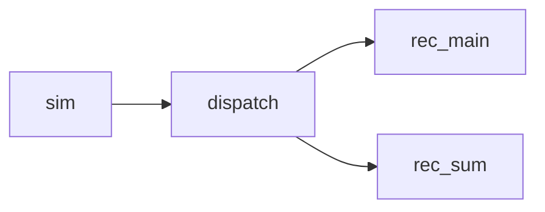

# Rules & Skill for creating and following a code spec

## When to use this skill

Use this file when the user asks to create, follow, implement from, or update a code specification.

## Key Rules

This file defines how to manage spec files.

- A spec should help both humans and LLMs understand a code-related functionality by capturing:
  - the intended functionality and interface
  - the code design used to implement it
  - the design considerations behind that design

- A spec should be implementation-aware, but it is not the implementation itself.

- The scope should stay code-focused, for example a module, feature, subsystem, service, API surface, data flow, UI behavior, or integration boundary.

- The format should work across stacks and architectures.

- Keep the spec clear, concise, and stable enough that plans and implementation tasks can reference its headings directly.

- Explain why the code design was chosen, but do not include broader product justification.

- When the user asks to create or update a spec, do not implement code unless implementation is explicitly requested as a separate task.

## Core spec structure

Each spec should describe one clear functionality scope and use this top-level structure:

- `# ...` document title
- `## Intent`
- `## Code Design`
- `## Design Considerations`

### Intent

Describe the what:

- the goal of the functionality
- the exposed interface or visible behavior
- the scope boundaries
- important inputs, outputs, and interactions when relevant
- use code blocks when appropriate to express concise pseudo types or visible API, CLI, or command surfaces for clarity

Do not explain broader product motivation here.

### Code Design

Describe the how:

- the main parts of the system or module
- the responsibilities of each part
- the relationships between parts
- important data flow, control flow, or lifecycle details
- the code-facing interfaces, contracts, or boundaries implementation should follow
- use code blocks when appropriate to express concise pseudo types, interfaces, message shapes, or command surfaces when that is clearer than prose
- use Mermaid diagrams for structure and flow, following `## Mermaid diagram rules`

Use subsections only when they improve clarity.

### Design Considerations

Describe the why of the chosen design:

- main design choices
- important tradeoffs and constraints
- assumptions that shaped the structure
- maintainability, performance, safety, UX, operational, or integration considerations when relevant
- use short code blocks when appropriate to clarify non-ambiguous pseudo types or API and command examples, while keeping the section concise

This section should explain the design choices, not restate the intent.

## Mermaid diagram rules

Diagrams show shape only. Details always go in bullets under the diagram, never inside the boxes.

### When to add a diagram

- Add a diagram when the reader needs to see structure: parts, connections, direction, or nesting.
- Do not add a diagram for a single part or a straight list of steps. Use a numbered list instead.
- Put diagrams in `## Code Design`, one per subsection, each with its own heading.
- Start each diagram subsection with a one-line `**Goal:**` stating what the diagram shows.

### One concern per diagram

Each diagram answers exactly one question. Pick one kind and do not mix kinds:

- **Process flow**: what runs and who talks to whom (programs, threads, services, workers).
- **Data flow**: what data moves and how it changes shape (file → record → batch → output).
- **Data model**: tables, entities, and their relations. Use `erDiagram`.
- **Sequence**: the order of messages over time (startup, shutdown, a request). Use `sequenceDiagram`, only when order matters.
- **Structure**: hierarchy or dependencies (crates, modules, folders).

If a diagram starts to need two kinds, split it into two diagrams.

### Size limits

- At most 6 boxes per diagram. If more are needed, split by concern or by level.
- `flowchart LR` for chains of up to 4 or 5 boxes across.
- `flowchart TD` for longer chains, trees, and dependency graphs.
- Branches are fine and keep it compact, for example one box fanning out to two stacked boxes.
- No `subgraph` unless the grouping is the point of the diagram, and then at most 2.
- Leave out side parts that do not connect (for example a background sampler) and mention them in the bullets with "(not drawn)".

### Labels

- Box labels are one or two words, the name used in the code or the spec.
- No `<br/>`, no descriptions, no file lists, no flag lists inside boxes.
- Edge labels are optional and at most one or two words, for example `|writes|`, `|drops|`.
- Use the same name for a part in every diagram and in the bullets.

### Syntax style

Write Mermaid so the raw text is readable without rendering:

- Use plain readable names as node IDs, for example `simulator --> dispatcher`.
- One arrow per line.
- Declare a node with brackets only when it needs a special shape or a label that is not a valid ID, and declare it once at the top:
  - `db[(name)]` for a database or file store
  - `lib_db[lib-db]` when the name has dashes, dots, or spaces
- After the declarations, use only bare IDs.
- No quotes, no styling, no `classDef`, no colors, no icons.
- Use `-.->` only for a weaker link, such as a read-only or optional dependency, and say so in the bullets.

### Bullets under the diagram

- Every box in the diagram gets exactly one bullet, in reading order.
- The bullet starts with the box label in bold, then a colon, then the details: `- **dispatch**: wraps each batch once and fans it out.`
- Put file paths, types, limits, and behaviors here.
- Use sub-bullets only when one box needs more than one line of detail.
- After the box bullets, add plain bullets for cross-cutting rules (ordering, failure, invariants).

### Example

````markdown
### Replay Threads

**Goal:** show the threads inside one replay process and who sends to whom.



- **sim**: reads input ticks and sends batches, paced by deadlines.
- **dispatch**: fans each batch out, main first, then sum.
- **rec_main**: writes the main recording.
- **rec_sum**: writes the 2 Hz summary. Absent with `--no-sum`.
- **sampler** (not drawn): samples CPU on the side and never touches the rings.
- A full main ring blocks dispatch. A full sum ring drops the batch.
````

### Before finishing a diagram, check

- One concern, one diagram kind.
- 6 boxes or fewer.
- Every label is one or two words.
- The raw Mermaid reads like a short list of connections.
- Every box has a bold bullet underneath.

## Markdown formatting rules

- Favor concise prose and bullets.
- Use `-` for bullet points.
- Use triple backticks for code blocks, not `~~~`. When a code block must contain another code block, wrap the outer one in four backticks.
- Leave exactly one empty line after headings.
- Keep sections in a predictable order.
- Use short content blocks and concrete wording.
- Wrap file paths in backticks.

## Spec writing rules

- Keep each spec focused on one functionality scope. Split it if it becomes too broad.
- Be concrete enough that implementation can follow without guessing the intended architecture.
- Prefer direct statements over low-value narrative.
- Avoid aspirational wording. Define the target design clearly.
- Do not include unrelated roadmap items, process notes, or product-level rationale.
- Name major modules, services, UI areas, or data structures directly when helpful.
- Keep terminology consistent.
- List open questions clearly when they exist.

## Relationship to planning and implementation

- A spec defines the intended functionality and code design.
- A plan breaks implementation into safe incremental steps.
- Implementation should follow the current spec unless the user asks to revise it.
- When a plan step depends on a spec, reference the relevant file or heading directly.

## Quality bar

A good spec should let a reader quickly answer:

- What functionality is being defined?
- What is its interface or visible behavior?
- How is the code structured?
- Why was this design chosen?

If those answers are not easy to find, revise the spec for clarity.
