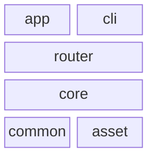
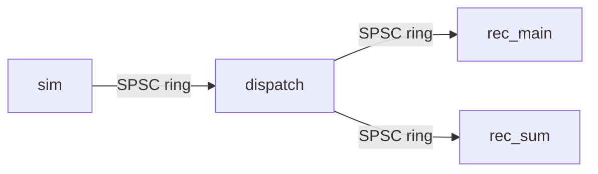
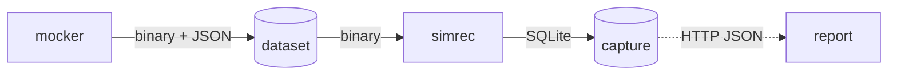

# Rules & Skill for creating and following a code spec

## When to use this skill

Use this file when the user asks to create, follow, implement from, or update a code specification.

## Key Rules

This file defines how to manage spec files.

- A spec should help both humans and LLMs understand a code-related functionality by capturing:
  - the intended functionality and interface
  - the code design used to implement it
  - the design considerations behind that design

- A spec should be implementation-aware, but it is not the implementation itself.

- The scope should stay code-focused, for example a module, feature, subsystem, service, API surface, data flow, UI behavior, or integration boundary.

- The format should work across stacks and architectures.

- Keep the spec clear, concise, and stable enough that plans and implementation tasks can reference its headings directly.

- Explain why the code design was chosen, but do not include broader product justification.

- When the user asks to create or update a spec, do not implement code unless implementation is explicitly requested as a separate task.

## Core spec structure

Each spec should describe one clear functionality scope and use this top-level structure:

- `# ...` document title
- `## Intent`
- `## Code Design`
- `## Design Considerations`

### Intent

Describe the what:

- the goal of the functionality
- the exposed interface or visible behavior
- the scope boundaries
- important inputs, outputs, and interactions when relevant
- use code blocks when appropriate to express concise pseudo types or visible API, CLI, or command surfaces for clarity

Do not explain broader product motivation here.

### Code Design

Describe the how:

- the main parts of the system or module
- the responsibilities of each part
- the relationships between parts
- important data flow, control flow, or lifecycle details
- the code-facing interfaces, contracts, or boundaries implementation should follow
- use code blocks when appropriate to express concise pseudo types, interfaces, message shapes, or command surfaces when that is clearer than prose
- start with a top-down System Overview of the key processes and components and how they talk to each other, then zoom in, following `### Diagram order`
- use Mermaid diagrams for structure and flow, following `## Mermaid diagram rules`

Use subsections only when they improve clarity.

### Design Considerations

Describe the why of the chosen design:

- main design choices
- important tradeoffs and constraints
- assumptions that shaped the structure
- maintainability, performance, safety, UX, operational, or integration considerations when relevant
- use short code blocks when appropriate to clarify non-ambiguous pseudo types or API and command examples, while keeping the section concise

This section should explain the design choices, not restate the intent.

## Mermaid diagram rules

Diagrams show shape only. Details always go in bullets under the diagram, never inside the boxes.

### When to add a diagram

- Add a diagram when the reader needs to see structure: parts, connections, direction, or nesting.
- Do not add a diagram for a single part or a straight list of steps. Use a numbered list instead.
- Put diagrams in `## Code Design`, one per subsection, each with its own heading.
- Start each diagram subsection with a one-line `**Goal:**` stating what the diagram shows. Do not mention these rules or box limits in it.

### One concern per diagram

Each diagram answers exactly one question. Pick one kind and do not mix kinds:

- **Process flow**: what runs and who talks to whom (programs, threads, services, workers).
- **Data flow**: what data moves and how it changes shape (file → record → batch → output).
- **Data model**: tables, entities, and their relations. Use `erDiagram`.
- **Sequence**: the order of messages over time (startup, shutdown, a request). Use `sequenceDiagram`, only when order matters.
- **Structure**: hierarchy (folders, nesting). Use `flowchart TD`.
- **Dependencies**: what depends on what (crates, packages, modules, services). Use a layer stack, see `### Dependency diagrams`.

If a diagram starts to need two kinds, split it into two diagrams.

### Diagram order

`## Code Design` reads top-down, from the whole project to the details. Diagrams appear in this order:

1. **System Overview** (process flow, always first): the key processes and components and who talks to whom. One box per running program, service, or major component, plus the main stores they share. No crates, modules, or threads here.
2. **Zoomed process flows**: one diagram per process that has internal parts worth showing (threads, workers, stages). Each zooms into one box from the overview, using the same name.
3. **Data flow**: how the main data changes shape, only if it is not obvious from the process flows.
4. **Data model**: tables and entities, when the scope stores data.
5. **Dependency stack**: crates, packages, or modules, see `### Dependency diagrams`.
6. **Sequence**: startup, shutdown, or request order, only when order matters.

- The System Overview answers "what runs, and what does it talk to?" before anything else.
- The System Overview is one diagram. Do not split it into one tiny diagram per program; independent programs that share a store still belong in the same picture.
- Programs connected only through a store do not imply that one launches the other. If they run independently, say so in the bullets instead of splitting the diagram.
- Every later diagram must connect back to a box in the System Overview, by name.
- Skip a step when it does not apply, but never move the System Overview down.
- Detailed rules, schemas, and tables come after the diagrams.

### Size limits

- At most 6 boxes per flowchart. If more are needed, split by concern or by level. Dependency stacks follow their own limits in `### Dependency diagrams`.
- `flowchart LR` for chains of up to 4 or 5 boxes across.
- `flowchart TD` for longer chains, trees, and dependency graphs.
- Branches are fine and keep it compact, for example one box fanning out to two stacked boxes.
- No `subgraph` unless the grouping is the point of the diagram, and then at most 2.
- Leave out side parts that do not connect (for example a background sampler) and mention them in the bullets with "(not drawn)".

### Labels

- Box labels are one or two words, the name used in the code or the spec.
- No `<br/>`, no descriptions, no file lists, no flag lists inside boxes.
- Use the same name for a part in every diagram and in the bullets.

### Edge labels

Label every connection with what travels over it, chosen for the context of the diagram:

- **Protocol or transport** between processes or services: `|HTTP|`, `|gRPC|`, `|WebSocket|`, `|Unix socket|`, `|stdin|`.
- **Message or channel kind** between threads or workers: `|SPSC ring|`, `|mpsc|`, `|event bus|`, `|callback|`.
- **Format or payload** for files, stores, and data flow: `|JSONL|`, `|SQLite|`, `|binary|`, `|Tick batch|`.
- **Action**, only when none of the above fits: `|writes|`, `|reads|`, `|drops|`.

Rules:

- One to three words, plain text, no punctuation that needs quotes (no parentheses, colons, or pipes).
- Pick the one fact the reader needs at that level. In the System Overview that is usually the protocol or format. In a zoomed flow it is usually the message kind or payload type.
- Do not repeat the box names in the label (`simrec -->|simrec output| capture` adds nothing).
- Use the same label for the same kind of connection across all diagrams.
- Details about the connection (capacity, backpressure, retry, schema) go in the bullets, not on the edge.
- If a connection has nothing meaningful to say, leave it unlabeled rather than inventing a label.

### Syntax style

Write Mermaid so the raw text is readable without rendering:

- Use plain readable names as node IDs, for example `simulator --> dispatcher`.
- One arrow per line.
- Edge labels use the pipe form, for example `sim -->|SPSC ring| dispatch`.
- Declare a node with brackets only when it needs a special shape or a label that is not a valid ID, and declare it once at the top:
  - `db[(name)]` for a database or file store
  - `lib_db[lib-db]` when the name has dashes, dots, or spaces
- After the declarations, use only bare IDs.
- No quotes, no styling, no `classDef`, no colors, no icons.
- Use `-.->` only for a weaker link, such as a read-only or optional dependency, and say so in the bullets.

### Dependency diagrams

Use these rules whenever a diagram shows what depends on what: crates, packages, libraries, modules, services, or layers.

- Draw dependencies as a **stack of layers**, not as a web of arrows.
- Build the layers bottom-up:
  - Bottom layer: parts with no internal dependencies.
  - Each next layer: parts that depend only on layers below it.
  - Parts in the same layer sit side by side.
- Use `block-beta` with `columns N`, where N is the widest layer. A part alone in its layer spans the full width with `:N`.
- The stack has no arrows. The rule is implied: a part may depend only on layers below it, never sideways or up.
- Put the exact dependencies in the bullets, one bullet per part, top layer first: `- **name**: uses a, b, c.`
- Mark foundation parts as `foundation, no internal deps`.
- End the bullets with the layer rule, and list any exception explicitly.
- If arrows are truly needed, use `flowchart TD` and draw only the nearest dependency. Drop every arrow already implied by a longer path (if A uses B and B uses C, do not draw A → C).
- The 6-box limit does not apply to stacks. A stack is limited by shape instead: at most 6 layers and at most 4 parts per layer.
- Always draw every part as its own box, by its real name. Never merge parts into a made-up group box like `role crates` or `helpers`.
- Only if the stack exceeds 6 layers or 4 parts in a layer, split it into two stacks (for example libraries and apps), each with real part names.

Example:

````markdown
### Library Dependencies

**Goal:** show the dependency layers of the library crates.



- **app**: uses router, core, common.
- **cli**: uses router, core, common, asset.
- **router**: uses core, common.
- **core**: uses common.
- **common**: foundation, no internal deps.
- **asset**: foundation, no internal deps, used only by cli.
- A part may depend only on layers below it, never sideways or up.
````

`block-beta` requires quoted labels, so it is the one exception to the no-quotes rule.

### Bullets under the diagram

- Every box in the diagram gets exactly one bullet, in reading order.
- The bullet starts with the box label in bold, then a colon, then the details: `- **dispatch**: wraps each batch once and fans it out.`
- Put file paths, types, limits, and behaviors here.
- Keep the main bullet to one short line: the role, plus the path if there is one.
- When a box holds several items (files, tables, fields, flags, message types), list them as sub-bullets, never as a comma-separated run in the main line:
  - One item per sub-bullet, wrapped in backticks.
  - Add a short note after the item when it helps: ``- `ticks.bin`: 40-byte records, no timestamps.``
  - A single item stays inline in the main bullet.
- Use sub-bullets also when one box needs more than one line of detail.
- After the box bullets, add plain bullets for cross-cutting rules (ordering, failure, invariants).

### Example

````markdown
### Replay Threads

**Goal:** show the threads inside one replay process and who sends to whom.



- **sim**: reads input ticks and sends `Vec<Tick>` batches, paced by deadlines.
- **dispatch**: fans each batch out, main first, then sum.
- **rec_main**: writes the main recording.
- **rec_sum**: writes the 2 Hz summary. Absent with `--no-sum`.
- **sampler** (not drawn): samples CPU on the side and never touches the rings.
- A full main ring blocks dispatch. A full sum ring drops the batch.
````

An overview-level example, with protocols and formats on the edges:

````markdown
### System Overview

**Goal:** show the programs, the stores they share, and how they connect.



- **mocker**: generates one dataset per run and exits.
- **dataset**: `sandbox/mock-data/NAME/`
  - `ticks.bin`: 40-byte tick records, no timestamps.
  - `story.jsonl`: one maneuver segment per line.
  - `manifest.json`: written last, marks the dataset complete.
- **simrec**: replays one dataset and writes one capture folder.
- **capture**: `sandbox/captured/NAME-SPEED/BACKEND/`
  - recording: `capture-main.sqlite` or raw segment files.
  - `capture-main-metrics.json`: published last.
  - `capture-main-ostel.jsonl`: CPU samples.
- **report**: static page that fetches metrics files over HTTP, read-only.
````

### Before finishing a diagram, check

- One concern, one diagram kind.
- 6 boxes or fewer (stacks: 6 layers, 4 parts per layer).
- Every box label is one or two words.
- Every meaningful edge is labeled with a protocol, message kind, or format, in three words or fewer.
- The raw Mermaid reads like a short list of connections.
- Every box has a bold bullet underneath.

## Markdown formatting rules

- Favor concise prose and bullets.
- Use `-` for bullet points.
- Use triple backticks for code blocks, not `~~~`. When a code block must contain another code block, wrap the outer one in four backticks.
- Leave exactly one empty line after headings.
- Keep sections in a predictable order.
- Use short content blocks and concrete wording.
- Wrap file paths in backticks.

## Spec writing rules

- Keep each spec focused on one functionality scope. Split it if it becomes too broad.
- Be concrete enough that implementation can follow without guessing the intended architecture.
- Prefer direct statements over low-value narrative.
- Avoid aspirational wording. Define the target design clearly.
- Do not include unrelated roadmap items, process notes, or product-level rationale.
- Name major modules, services, UI areas, or data structures directly when helpful.
- Keep terminology consistent.
- List open questions clearly when they exist.

## Relationship to planning and implementation

- A spec defines the intended functionality and code design.
- A plan breaks implementation into safe incremental steps.
- Implementation should follow the current spec unless the user asks to revise it.
- When a plan step depends on a spec, reference the relevant file or heading directly.

## Quality bar

A good spec should let a reader quickly answer:

- What functionality is being defined?
- What is its interface or visible behavior?
- How is the code structured?
- Why was this design chosen?

If those answers are not easy to find, revise the spec for clarity.